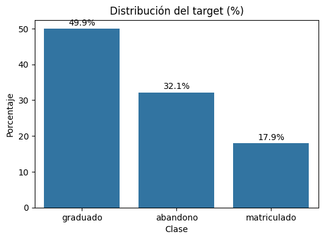
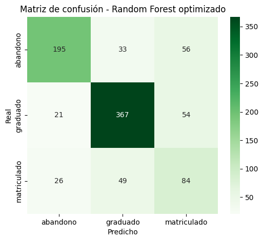
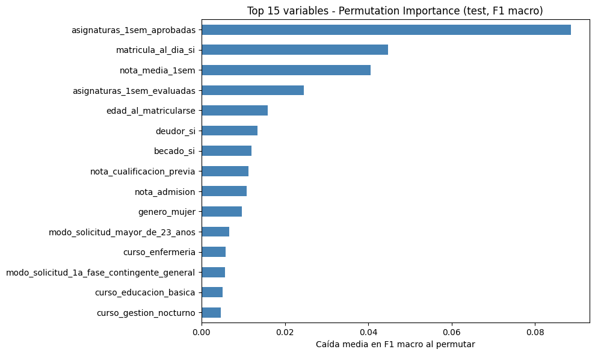
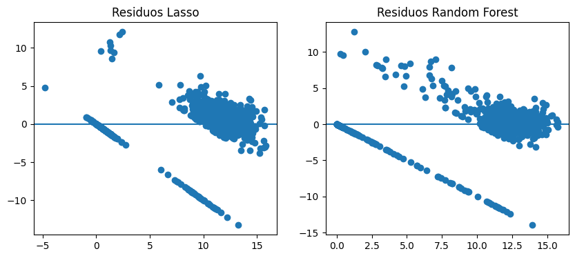
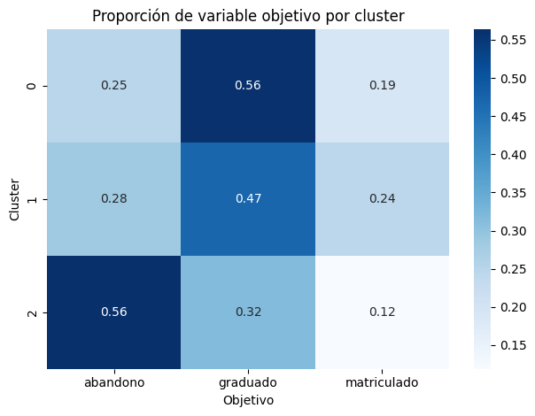

[English](README.md) | **Español**

# Predicción del abandono y el éxito académico en educación superior

Proyecto completo de machine learning sobre 4.424 estudiantes universitarios: **clasificación multiclase** de la situación final de cada estudiante (abandono / sigue matriculado / graduado), **regresión** de su nota media del segundo semestre y **aprendizaje no supervisado** para identificar perfiles de estudiantes.

La restricción que guía todo el proyecto es **evitar la fuga de información (data leakage)**: todos los modelos usan solo información disponible *antes* del segundo semestre, de modo que las predicciones podrían usarse realmente para intervenir a tiempo.

> Proyecto final individual de *Aprendizaje Automático*, 2º curso del Grado en Ingeniería Matemática e Inteligencia Artificial, ICAI – Universidad Pontificia Comillas (curso 2025/26).


---

## Resultados principales

| Tarea | Mejor modelo | Rendimiento en test | Referencia |
|---|---|---|---|
| Clasificación (3 clases) | Random Forest optimizado | **F1-macro 0,680**, accuracy 0,730 | Clase mayoritaria: F1-macro 0,222 |
| Regresión (nota 2º semestre, escala 0–20) | Lasso (α = 0,05) | **R² 0,743**, RMSE 2,64 | Predicción de la media: RMSE 5,20 |
| Clustering | K-Means (k = 3) | Silhouette 0,107; un cluster con **56 %** de abandono frente al 32 % global | — |

**Conclusión principal:** el rendimiento del primer semestre (asignaturas aprobadas y nota media) domina en las tres tareas: lo señalan las importancias del Random Forest, los coeficientes de Lasso y el eje principal del clustering. La regularidad administrativa (matrícula al día) es la señal no académica más fuerte. Todas las conclusiones son predictivas, no causales.

---

## El problema

El dataset describe a los estudiantes en el momento de la matrícula (datos demográficos, formación previa, situación socioeconómica y administrativa, contexto macroeconómico) junto con su rendimiento académico en el primer y segundo semestre. La variable objetivo tiene tres clases con un desbalance moderado:

<p align="center">
  
</p>

| Clase | Proporción |
|---|---|
| Graduado | 49,9 % |
| Abandono | 32,1 % |
| Matriculado | 17,9 % |

## Metodología

**Control de la fuga de información.** Todas las variables del segundo semestre (asignaturas matriculadas, evaluadas, aprobadas, convalidadas y sin evaluación, además de la propia nota) se excluyen de todas las tareas predictivas, porque son contemporáneas al resultado o prácticamente equivalentes a él. En la regresión se excluye también la variable `objetivo`.

**Preprocesado.** No hay valores ausentes ni duplicados. Los valores extremos (z-score) se mantuvieron a propósito, porque corresponden a perfiles reales, como estudiantes de mayor edad o con convalidaciones, y no a errores de medida. La codificación one-hot convierte los 30 predictores en 232 columnas.

**Evaluación.** División train/test 80/20 (estratificada en clasificación) y validación cruzada de 5 pliegues. Los hiperparámetros se ajustan con `GridSearchCV` / `RandomizedSearchCV` **solo sobre el conjunto de entrenamiento**. El escalado va dentro de `Pipeline`s, de modo que se ajusta en cada pliegue. Todos los modelos se comparan con un modelo dummy de referencia.

### 1. Clasificación: abandono / matriculado / graduado

La métrica principal es el **F1-macro**, porque la accuracy premia ignorar la clase minoritaria *matriculado*, que es precisamente el grupo que más interesa para intervenir.

| Modelo | Accuracy | F1-macro |
|---|---|---|
| Dummy (clase mayoritaria) | 0,499 | 0,222 |
| Regresión logística | 0,736 | 0,650 |
| Árbol de decisión | 0,725 | 0,609 |
| Random Forest | 0,738 | 0,624 |
| Regresión logística (optimizada, clases balanceadas) | 0,697 | 0,650 |
| Árbol de decisión (optimizado) | 0,623 | 0,599 |
| **Random Forest (optimizado)** | **0,730** | **0,680** |

El Random Forest optimizado (`n_estimators=200`, `max_depth=10`, `class_weight='balanced'`) sacrifica un poco de accuracy a cambio de un equilibrio mucho mejor entre clases: el recall de *matriculado* sube de 0,21 a 0,53.

<p align="center">
  
  
</p>

- *Matriculado* es la clase más difícil: es un estado intermedio y heterogéneo que se confunde sobre todo con *graduado*.
- La permutation importance en test (caída del F1-macro) coincide con el ranking basado en impureza: asignaturas aprobadas en el 1er semestre (0,089), matrícula al día (0,045) y nota media del 1er semestre (0,041).
- El balanceo de clases por sí solo no explica la mejora: en un Random Forest de 100 árboles, `class_weight='balanced'` llega a *empeorar* el F1-macro (0,624 → 0,592). La mejora procede de ajustar conjuntamente la profundidad, el número de árboles y el balanceo.

### 2. Regresión: nota media del segundo semestre

Variable objetivo: `nota_media_2sem`, predicha solo con datos de matrícula y rendimiento del primer semestre.

| Modelo | RMSE test | MAE test | R² test | RMSE CV (train) |
|---|---|---|---|---|
| Dummy (media) | 5,203 | 4,022 | 0,000 | 5,213 |
| Regresión lineal (MCO) | inestable* | inestable* | inestable* | inestable* |
| Ridge (α = 100) | 2,674 | 1,606 | 0,736 | 2,691 |
| **Lasso (α = 0,05)** | **2,637** | 1,506 | **0,743** | 2,950 |
| Árbol de decisión | 2,775 | 1,439 | 0,716 | 3,305 |
| Random Forest | 2,667 | **1,393** | 0,737 | **2,478** |

Lasso obtiene el mejor R² en test y un modelo disperso e interpretable; Random Forest tiene el menor MAE y el mejor RMSE en validación cruzada. Ambos coinciden en los dos predictores dominantes: la nota media del 1er semestre (coeficiente de Lasso 2,81 sobre variables estandarizadas) y las asignaturas aprobadas (2,08).

\* **Por qué la regresión lineal ordinaria es inestable.** Tras la codificación one-hot, la matriz de diseño escalada tiene 232 columnas pero **rango 221** (6 columnas no tienen varianza en el conjunto de entrenamiento y otras son combinaciones lineales exactas). Por tanto, el problema de mínimos cuadrados no tiene solución única y el resultado depende de la librería de álgebra lineal de cada plataforma. En la ejecución original en Windows los coeficientes se dispararon (RMSE en test ≈ 1,1·10¹³); en Linux se obtiene la solución de norma mínima (R² ≈ 0,73). En ambos casos la conclusión es la misma: este espacio de variables necesita regularización. El notebook incluye el diagnóstico del rango.

<p align="center">
  
</p>

Las bandas diagonales de los residuos no son ruido. La banda inferior sigue exactamente la recta *residuo = −predicción*, es decir, son estudiantes cuya nota real del segundo semestre es **0**. El **19,7 %** de los estudiantes tiene un 0 (ninguna asignatura aprobada), y el 84 % de ellos acaba abandonando. La variable objetivo es, por tanto, una mezcla de "sin nota" y notas reales, algo que un único regresor continuo no puede capturar del todo (ver *Próximos pasos*).

### 3. Aprendizaje no supervisado: perfiles de estudiantes

El PCA muestra que la información está repartida en muchas dimensiones: las dos primeras componentes explican solo el **4 %** de la varianza y hacen falta 132 componentes para llegar al 80 %. Se evaluó K-Means para k = 2…10 (silhouette e inercia). Como no hay un codo claro y la silhouette es baja en todos los casos (máximo 0,113 con k = 2 y 0,107 con k = 3), se eligió **k = 3** por interpretabilidad. El clustering jerárquico (Ward) da una partición comparable (ARI = 0,53).

<p align="center">
  
</p>

| Cluster | Tamaño | Perfil | Abandono | Graduados |
|---|---|---|---|---|
| 0 | 3.058 | Mayoritario, edad típica (~20), rendimiento medio | 24,7 % | 56,2 % |
| 1 | 376 | Mejores notas de admisión, algo mayores (~22) | 28,5 % | 47,1 % |
| 2 | 990 | Estudiantes de mayor edad (media ~34), peor primer semestre | **56,4 %** | 31,7 % |

Las etiquetas no se usaron para construir los clusters y, aun así, el cluster 2 concentra el riesgo de abandono. Su rasgo más distintivo, la edad al matricularse, se conoce **antes de que exista ninguna nota**, así que este perfil de riesgo puede detectarse desde el primer día. Los clusters se solapan bastante: describen un continuo, no grupos claramente separados.

## Conclusiones

1. **El rendimiento del primer semestre es la señal más fuerte** tanto para el resultado final como para la nota del segundo semestre, de forma consistente en tres análisis independientes.
2. **Las variables administrativas y socioeconómicas** (matrícula al día, deudor, beca) aportan información útil pero secundaria.
3. **La disciplina metodológica importa más que el modelo elegido:** excluir las variables del segundo semestre y regularizar los modelos lineales evita resultados artificialmente optimistas.
4. ***Matriculado* es la clase difícil**, por ser un estado intermedio entre el abandono y la graduación.
5. **Predecir no es explicar causas.** Una variable que ayuda a predecir el abandono (p. ej., la matrícula al día) puede reflejar circunstancias económicas o personales; actuar directamente sobre ella no tiene por qué cambiar el resultado.

## Limitaciones y próximos pasos

- **Variable objetivo de regresión con exceso de ceros:** un modelo en dos etapas (hurdle), primero *¿tendrá nota el estudiante?* y después *¿qué nota?*, probablemente eliminaría las bandas de los residuos.
- **Alta dimensionalidad por la codificación one-hot:** agrupar categorías poco frecuentes o usar target encoding (dentro de la validación cruzada) podría mejorar la estabilidad.
- **Calibración de probabilidades y ajuste del umbral** para la clase *abandono*, para alinear el clasificador con el coste real de no detectar a un estudiante en riesgo.
- **Una sola institución:** los resultados pueden no generalizarse a otras universidades o países.

## Estructura del repositorio

```
student-success-ml/
├── data/
│   └── rendimiento_estudiantes.csv        # Dataset (columnas en español, separador ';')
├── notebooks/
│   ├── 01_exploratory_data_analysis.ipynb # EDA y decisiones de preprocesado
│   ├── 02_classification.ipynb            # Tarea 1: abandono / matriculado / graduado
│   ├── 03_regression.ipynb                # Tarea 2: nota media del 2º semestre
│   └── 04_unsupervised.ipynb              # Tarea 3: PCA + clustering
├── report/
│   └── report_es.pdf                      # Memoria completa (en español)
├── figures/                               # Figuras usadas en este README
├── requirements.txt
└── README.md / README.es.md
```

## Cómo reproducir los resultados

**Requisitos:** Python 3.12 y unos 3 minutos de ejecución en un portátil.

1. **Clonar el repositorio**
   ```bash
   git clone https://github.com/jimenazubii/student-success-ml.git
   cd student-success-ml
   ```

2. **Crear un entorno virtual e instalar las dependencias fijadas**
   ```bash
   python3.12 -m venv .venv
   source .venv/bin/activate          # Windows: .venv\Scripts\activate
   pip install -r requirements.txt
   ```

3. **Ejecutar los notebooks**, de forma interactiva:
   ```bash
   jupyter notebook notebooks/
   ```
   o sin interfaz, los cuatro en orden:
   ```bash
   cd notebooks
   for nb in 01_*.ipynb 02_*.ipynb 03_*.ipynb 04_*.ipynb; do
     jupyter nbconvert --to notebook --execute --inplace "$nb"
   done
   ```
   Cada notebook carga los datos de `data/` por su cuenta, así que también pueden ejecutarse por separado. Deben ejecutarse desde la carpeta `notebooks/` (la ruta a los datos es relativa).

4. **Comprobar los resultados.** Con las versiones fijadas se obtienen exactamente las cifras de este README:
   - `02_classification.ipynb`, última celda → Random Forest optimizado: accuracy **0,7299**, F1-macro **0,6804**
   - `03_regression.ipynb` → Lasso: RMSE **2,637**, R² **0,743**
   - `04_unsupervised.ipynb` → tamaños de los clusters **3058 / 376 / 990**, silhouette **0,107** (k = 3)

**Notas de reproducibilidad**
- Todos los procesos aleatorios usan `random_state=42`.
- `scikit-learn` está fijado a la versión **1.7.2** a propósito: a partir de la 1.8 los resultados del Random Forest cambian ligeramente (p. ej., F1-macro 0,6796 en lugar de 0,6804) y la comparación del balanceo de clases cambia de forma apreciable.
- El único resultado que depende de la plataforma es el de la regresión lineal sin regularizar, explicado más arriba.

## Dataset

Los datos son una versión traducida al español, preparada para la asignatura, del dataset de UCI *Predict Students' Dropout and Academic Success* (Instituto Politécnico de Portalegre, Portugal). Se renombraron las columnas al español y los códigos numéricos de las variables categóricas se sustituyeron por etiquetas legibles.

> Realinho, V., Vieira Martins, M., Machado, J., & Baptista, L. (2021). *Predict Students' Dropout and Academic Success* [Dataset]. UCI Machine Learning Repository. https://doi.org/10.24432/C5MC89. Licencia [CC BY 4.0](https://creativecommons.org/licenses/by/4.0/).

## Autora

**Jimena Zubizarreta**, Grado en Ingeniería Matemática e Inteligencia Artificial, ICAI – Universidad Pontificia Comillas, Madrid.
