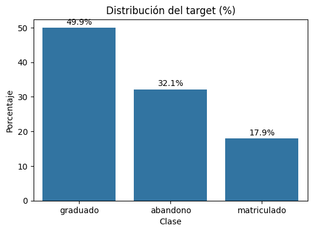
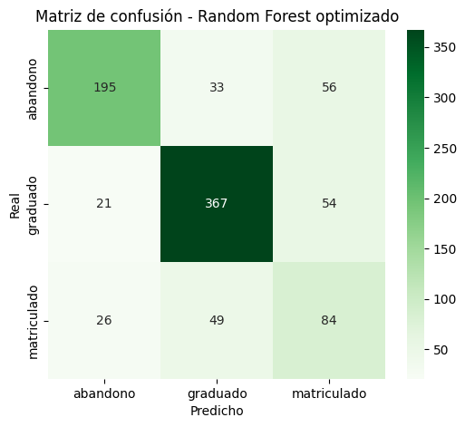
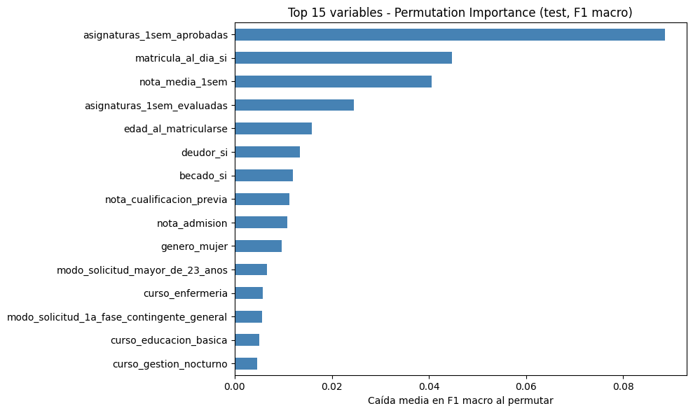
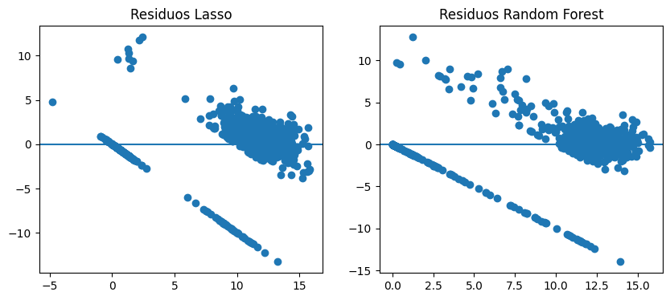
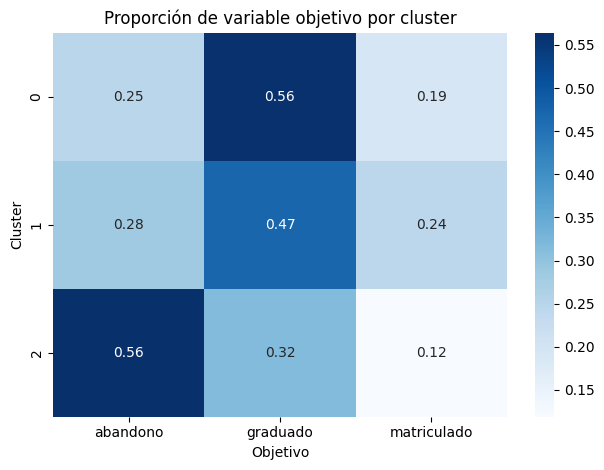

**English** | [Español](README.es.md)

# Predicting Student Dropout and Academic Success

End-to-end machine learning project on 4,424 higher-education students: **multiclass classification** of each student's final outcome (dropout / still enrolled / graduate), **regression** of their second-semester average grade, and **unsupervised learning** to find student profiles.

The guiding constraint throughout the project is **avoiding data leakage**: every model only uses information available *before* the second semester, so the predictions could actually be used for early intervention.

> Individual final project for *Machine Learning (Aprendizaje Automático)*, 2nd year of the BSc in Mathematical Engineering and Artificial Intelligence, ICAI – Universidad Pontificia Comillas (2025/26).


---

## Key results

| Task | Best model | Test performance | Baseline |
|---|---|---|---|
| Classification (3 classes) | Tuned Random Forest | **F1-macro 0.680**, accuracy 0.730 | Majority class: F1-macro 0.222 |
| Regression (2nd-semester grade, 0–20 scale) | Lasso (α = 0.05) | **R² 0.743**, RMSE 2.64 | Mean predictor: RMSE 5.20 |
| Clustering | K-Means (k = 3) | Silhouette 0.107; one cluster with **56 %** dropout vs. 32 % overall | — |

**Main finding:** first-semester performance (subjects passed and average grade) dominates in all three tasks: Random Forest importances, Lasso coefficients and the clustering axis all point to it. Administrative regularity (tuition fees up to date) is the strongest non-academic signal. All conclusions are predictive, not causal.

---

## The problem

The dataset describes students at enrolment (demographics, prior education, socioeconomic and administrative status, macroeconomic context) plus their academic performance in the first and second semesters. The target has three classes with moderate imbalance:

<p align="center">
  
</p>

| Class | Share |
|---|---|
| Graduate | 49.9 % |
| Dropout | 32.1 % |
| Enrolled | 17.9 % |

## Methodology

**Leakage control.** All second-semester variables (enrolled, evaluated, approved, credited and non-evaluated subjects, plus the grade itself) are excluded from every predictive task, because they are contemporaneous with, or nearly equivalent to, the outcome. In the regression task the final `objetivo` (outcome) label is excluded too.

**Preprocessing.** No missing values or duplicates. Outliers (z-score) were kept on purpose: they correspond to real profiles such as mature students or credit transfers, not measurement errors. One-hot encoding expands 30 predictors into 232 columns.

**Evaluation.** 80/20 train/test split (stratified for classification) and 5-fold cross-validation. Hyperparameters are tuned with `GridSearchCV` / `RandomizedSearchCV` **on the training set only**. Scaling lives inside `Pipeline`s, so it is fitted per fold. Every model is compared against a dummy baseline.

### 1. Classification: dropout / enrolled / graduate

The primary metric is **F1-macro**, because accuracy rewards ignoring the minority *enrolled* class, which is precisely the group that matters for intervention.

| Model | Accuracy | F1-macro |
|---|---|---|
| Dummy (majority class) | 0.499 | 0.222 |
| Logistic Regression | 0.736 | 0.650 |
| Decision Tree | 0.725 | 0.609 |
| Random Forest | 0.738 | 0.624 |
| Logistic Regression (tuned, class-balanced) | 0.697 | 0.650 |
| Decision Tree (tuned) | 0.623 | 0.599 |
| **Random Forest (tuned)** | **0.730** | **0.680** |

The tuned Random Forest (`n_estimators=200`, `max_depth=10`, `class_weight='balanced'`) trades a little accuracy for a much better balance across classes: recall on *enrolled* rises from 0.21 to 0.53.

<p align="center">
  
  
</p>

- *Enrolled* is the hardest class: it is an intermediate, heterogeneous state that is mostly confused with *graduate*.
- Permutation importance on the test set (drop in F1-macro) agrees with the impurity-based ranking: subjects passed in semester 1 (0.089), tuition fees up to date (0.045) and semester-1 average grade (0.041).
- Class weighting alone does not explain the gain: on a 100-tree Random Forest, `class_weight='balanced'` actually *lowers* F1-macro (0.624 → 0.592). The improvement comes from tuning depth, number of trees and weighting together.

### 2. Regression: second-semester average grade

Target: `nota_media_2sem`, predicted only from enrolment data and first-semester performance.

| Model | Test RMSE | Test MAE | Test R² | CV RMSE (train) |
|---|---|---|---|---|
| Dummy (mean) | 5.203 | 4.022 | 0.000 | 5.213 |
| Linear Regression (OLS) | unstable* | unstable* | unstable* | unstable* |
| Ridge (α = 100) | 2.674 | 1.606 | 0.736 | 2.691 |
| **Lasso (α = 0.05)** | **2.637** | 1.506 | **0.743** | 2.950 |
| Decision Tree | 2.775 | 1.439 | 0.716 | 3.305 |
| Random Forest | 2.667 | **1.393** | 0.737 | **2.478** |

Lasso gives the best test R² and a sparse, interpretable model; Random Forest has the lowest MAE and the best cross-validated RMSE. Both agree on the two dominant predictors: semester-1 average grade (Lasso coefficient 2.81 on standardised features) and subjects passed (2.08).

\* **Why OLS is unstable.** After one-hot encoding, the scaled design matrix has 232 columns but **rank 221** (6 columns have zero variance in the training split, others are exact linear combinations). Ordinary least squares therefore has no unique solution, and the result depends on the platform's linear-algebra backend. In the original run on Windows the coefficients exploded (test RMSE ≈ 1.1·10¹³). On Linux the minimum-norm solution is returned instead (R² ≈ 0.73). Either way, the conclusion is the same: this feature space needs regularisation. The notebook includes the rank diagnostic.

<p align="center">
  
</p>

The diagonal bands in the residuals are not noise. The lower band lies exactly on *residual = −prediction*, i.e. students whose real second-semester grade is **0**. **19.7 %** of students have a 0 (no subject passed), and 84 % of them eventually drop out. The target is therefore a mix of "no grade" and actual grades, which a single continuous regressor cannot fully capture (see *Next steps*).

### 3. Unsupervised learning: student profiles

PCA shows that the information is spread across many dimensions: the first two components explain only **4 %** of the variance and 132 components are needed for 80 %. K-Means was evaluated for k = 2…10 (silhouette and inertia). With no clear elbow and low silhouette everywhere (max. 0.113 at k = 2, 0.107 at k = 3), **k = 3** was chosen for interpretability. Agglomerative clustering (Ward) gives a comparable partition (ARI = 0.53).

<p align="center">
  
</p>

| Cluster | Size | Profile | Dropout | Graduate |
|---|---|---|---|---|
| 0 | 3,058 | Majority, typical age (~20), average performance | 24.7 % | 56.2 % |
| 1 | 376 | Highest admission grades, slightly older (~22) | 28.5 % | 47.1 % |
| 2 | 990 | Mature students (mean age ~34), weakest first semester | **56.4 %** | 31.7 % |

The labels were never used to build the clusters, yet cluster 2 concentrates dropout risk. Its most distinctive trait, age at enrolment, is known **before any grade exists**, so this risk profile can be flagged from day one. The clusters overlap considerably: they describe a continuum, not sharply separated groups.

## Conclusions

1. **First-semester performance is the strongest signal** for both final outcome and second-semester grade, consistently across three independent analyses.
2. **Administrative and socioeconomic variables** (fees up to date, debtor, scholarship) add useful but secondary information.
3. **Methodological discipline matters more than model choice:** excluding second-semester variables and regularising linear models avoids artificially optimistic results.
4. ***Enrolled* is the hard class**, as an intermediate state between dropout and graduation.
5. **Predictive ≠ causal.** A variable that helps predict dropout (e.g. fees up to date) may be a proxy for financial or personal circumstances; intervening on it directly may not change the outcome.

## Limitations and next steps

- **Zero-inflated regression target:** a two-stage (hurdle) model, first *will the student have a grade?* and then *which grade?*, would likely remove the residual bands.
- **High dimensionality from one-hot encoding:** grouping rare categories or using target encoding (inside CV) could improve stability.
- **Probability calibration and threshold tuning** for the *dropout* class, to align the classifier with the real cost of missing an at-risk student.
- **Single institution:** results may not generalise to other universities or countries.

## Repository structure

```
student-success-ml/
├── data/
│   └── rendimiento_estudiantes.csv        # Dataset (Spanish column names, ';' separator)
├── notebooks/
│   ├── 01_exploratory_data_analysis.ipynb # EDA and preprocessing decisions
│   ├── 02_classification.ipynb            # Task 1: dropout / enrolled / graduate
│   ├── 03_regression.ipynb                # Task 2: 2nd-semester average grade
│   └── 04_unsupervised.ipynb              # Task 3: PCA + clustering
├── report/
│   └── report_es.pdf                      # Full written report (Spanish)
├── figures/                               # Figures used in this README
├── requirements.txt
└── README.md / README.es.md
```

The notebooks and report are written in Spanish; variable names follow the Spanish version of the dataset (e.g. `asignaturas_1sem_aprobadas` = subjects passed in semester 1).

## How to reproduce the results

**Requirements:** Python 3.12 and about 3 minutes of runtime on a laptop.

1. **Clone the repository**
   ```bash
   git clone https://github.com/jimenazubii/student-success-ml.git
   cd student-success-ml
   ```

2. **Create a virtual environment and install the pinned dependencies**
   ```bash
   python3.12 -m venv .venv
   source .venv/bin/activate          # Windows: .venv\Scripts\activate
   pip install -r requirements.txt
   ```

3. **Run the notebooks**, either interactively:
   ```bash
   jupyter notebook notebooks/
   ```
   or headless, all four in order:
   ```bash
   cd notebooks
   for nb in 01_*.ipynb 02_*.ipynb 03_*.ipynb 04_*.ipynb; do
     jupyter nbconvert --to notebook --execute --inplace "$nb"
   done
   ```
   Each notebook loads the data from `data/` on its own, so they can also be run independently. They must be run from the `notebooks/` folder (the data path is relative).

4. **Check the results.** With the pinned versions you should get exactly the numbers in this README:
   - `02_classification.ipynb`, last cell → tuned Random Forest: accuracy **0.7299**, F1-macro **0.6804**
   - `03_regression.ipynb` → Lasso: RMSE **2.637**, R² **0.743**
   - `04_unsupervised.ipynb` → cluster sizes **3058 / 376 / 990**, silhouette **0.107** (k = 3)

**Reproducibility notes**
- All random processes use `random_state=42`.
- `scikit-learn` is pinned to **1.7.2** on purpose: from version 1.8 onwards the Random Forest results change slightly (e.g. F1-macro 0.6796 instead of 0.6804), and the class-weighting comparison changes noticeably.
- The only platform-dependent result is the unregularised linear regression, explained above.

## Dataset

The data is a Spanish-translated version, prepared for the course, of the UCI *Predict Students' Dropout and Academic Success* dataset (Polytechnic Institute of Portalegre, Portugal). Column names were renamed to Spanish and numeric category codes were replaced by readable labels.

> Realinho, V., Vieira Martins, M., Machado, J., & Baptista, L. (2021). *Predict Students' Dropout and Academic Success* [Dataset]. UCI Machine Learning Repository. https://doi.org/10.24432/C5MC89. Licensed under [CC BY 4.0](https://creativecommons.org/licenses/by/4.0/).

## Author

**Jimena Zubizarreta**, BSc in Mathematical Engineering and Artificial Intelligence, ICAI – Universidad Pontificia Comillas, Madrid.
